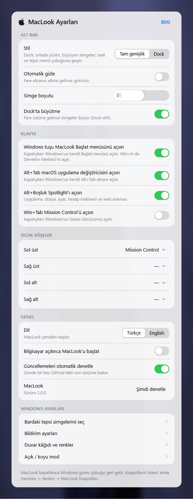

# MacLook

Windows 11'e macOS görünümü kazandıran bir masaüstü uygulaması. Windows'un görev çubuğunu gizler; yerine macOS tarzı bir menü çubuğu, alt bar ya da Dock, Başlat menüsü, Denetim Merkezi, Bildirim Merkezi, Spotlight, Mission Control, Launchpad ve Alt+Tab uygulama değiştiricisi koyar. Kapatınca her şey eski hâline döner.

*A macOS look for Windows 11: menu bar, Dock, Control Center, Notification Center, Spotlight, Mission Control, Launchpad and an Alt+Tab app switcher. The interface is available in Turkish and English (MacLook Settings → General → Language).*



## Özellikler

**Menü çubuğu (üstte)**
- Logo menüsü: Bu Bilgisayar Hakkında, Sistem Ayarları, Uyku, Yeniden Başlat, Kapat, MacLook Ayarları; yeni sürüm çıkınca en üstte görünür
- Öndeki uygulamanın adı ve Dosya / Düzen / Görünüm / Pencere / Yardım menüleri (kısayolları öndeki uygulamaya gönderir)
- Spotlight ve Denetim Merkezi düğmeleri; Dock stilinde tepsi ikonları ve saat de burada durur
- Duvar kâğıdına göre otomatik açık / koyu yazı, buzlu cam arka plan

**Alt bar ya da Dock** (Ayarlar → Alt Bar → Stil)
- **Tam genişlik:** solda logo (Başlat menüsü), sabitlenmiş ve açık uygulamalar; sağda gizli simgeler (^), gerçek tepsi ikonları, dil, ağ / ses, saat ve masaüstünü göster köşesi
- **Dock:** ortada yüzen, fare üstüne gelince büyüyen simgeler
- Otomatik gizleme ve simge boyutu ayarı
- Açık uygulamanın altında nokta, üstünde durunca canlı pencere önizlemeleri
- Sürükle-bırak ile sıralama, yukarı sürükleyip bırakarak kaldırma
- Orta tık: yeni pencere, sağ tık: pencere listesi ve menü
- Ses ikonunun üstünde fare tekerleği ile ses ayarı

**Paneller**
- **Başlat menüsü** (Windows tuşu): arama, Sabitlenenler, Önerilenler (son dosyalar), Tüm Uygulamalar, hesap ve güç menüsü
- **Spotlight** (Alt+Boşluk ya da menü çubuğundaki büyüteç): uygulamalar, Windows Arama dizinindeki dosyalar, Windows ayar sayfaları, hesap makinesi ve web araması. Ctrl+Enter dosyayı klasöründe gösterir
- **Denetim Merkezi** (Win+A): ağ, Wi-Fi / Bluetooth, Odak, Gece Işığı, Yansıt, parlaklık (harici monitörlerde DDC/CI ile), ses ve çıkış aygıtı seçimi, Şimdi Çalıyor
- **Bildirim Merkezi** (saate tıkla): büyük saat, takvim ve uygulamaya göre gruplanmış Windows bildirimleri
- **Mission Control** (sol üst köşe, Pencere menüsü ya da isteğe bağlı Win+Tab): açık pencerelerin hepsi canlı önizlemeyle
- **Launchpad**: tüm uygulamalar tam ekran, sayfa sayfa; sürükleyerek sıralama, bir simgeyi diğerinin üstüne bırakarak klasör oluşturma
- **Alt+Tab**: macOS uygulama değiştiricisi (Q: uygulamadan çık, Esc: vazgeç)

**Diğer**
- **Birden fazla monitör:** her ekranda kendi menü çubuğu ve barı / Dock'u; monitör takılıp çıkarılınca kendini yeniler
- **Sıcak köşeler:** ekran köşesine fareyi itince Mission Control, Masaüstü, Launchpad, Başlat menüsü, Bildirim Merkezi, Spotlight ya da Ekranı Kilitle (tam ekran oyun ve videolarda devre dışı)
- **Otomatik güncelleme denetimi:** günde bir kez GitHub'daki son sürüme bakar
- **Türkçe / English** arayüz
- Wallpaper Engine kullanılıyorsa bulanık arka planlar onun seçili duvar kâğıdından alınır

## Gereksinimler

- Windows 11 (Windows 10 2004 ve üzeri çoğunlukla çalışır)
- Yayınlanan sürüm kendi içinde .NET'i taşır, ayrıca kurulum gerekmez

## Kurulum

1. [Releases](../../releases) sayfasından son sürümün `.zip` dosyasını indirin.
2. Bir klasöre çıkarın ve `MacLook.exe`'yi çalıştırın.
3. İsterseniz logo menüsü → **MacLook Ayarları** → *Bu bilgisayara kur*: MacLook Başlat menüsüne eklenir ve Ayarlar → Uygulamalar'dan kaldırılabilir (yönetici izni gerekmez).
4. Bilgisayar açılınca başlaması için: **MacLook Ayarları** → *Bilgisayar açılınca MacLook'u başlat*.

**Kapatmak:** logo menüsü → **MacLook'tan Çık**. Windows görev çubuğu geri gelir.

Görev çubuğu bir şekilde gizli kalırsa:

```
MacLook.exe --restore-taskbar
```

## Kısayollar

| Kısayol | İşlev |
| --- | --- |
| Windows tuşu | Başlat menüsü |
| Win+A | Denetim Merkezi |
| Alt+Boşluk | Spotlight |
| Alt+Tab | Uygulama değiştirici |
| Win+Tab | Mission Control (Ayarlar'dan açılırsa) |
| Win+D / sağ alt köşe | Masaüstünü göster |
| Ctrl+Esc | Windows'un kendi Başlat menüsü |

Kısayolların hepsi MacLook Ayarları → Klavye'den açılıp kapatılabilir.

## Derleme

[.NET 10 SDK](https://dotnet.microsoft.com/download) gerekir.

```
dotnet build -c Release
dotnet publish -c Release -r win-x64 --self-contained -p:PublishSingleFile=true -p:IncludeNativeLibrariesForSelfExtract=true -p:EnableCompressionInSingleFile=true
```

Komut satırı seçenekleri:

| Seçenek | İşlev |
| --- | --- |
| `--exit` | Çalışan MacLook'u kapatır |
| `--restore-taskbar` | Windows görev çubuğunu geri getirir |
| `--uninstall` | Kurulu MacLook'u kaldırır |
| `--snapshot <klasör> [tr\|en]` | Panelleri ekranda göstermeden PNG olarak çizer (tasarım kontrolü için) |

Ayarlar `%APPDATA%\MacLook\config.json` dosyasında tutulur.

## Bilinen sınırlamalar

- Pencere başlık çubukları Windows tarzında kalır.
- Yönetici olarak çalışan bir pencere öndeyken Windows tuşu ve Alt+Tab yakalanamaz.
- Harici monitör parlaklığı yalnızca DDC/CI destekleyen monitörlerde çalışır.
- Ses çıkış aygıtı seçimi Windows'un belgelenmemiş bir arayüzünü kullanır.

## Teşekkürler

- [ManagedShell](https://github.com/cairoshell/ManagedShell): sistem tepsisi ikonları

---

Apple, macOS ve Apple logosu Apple Inc.'in ticari markalarıdır. Bu proje Apple ile bağlantılı değildir; yalnızca görünüm benzetmesi yapan bağımsız bir uygulamadır.
